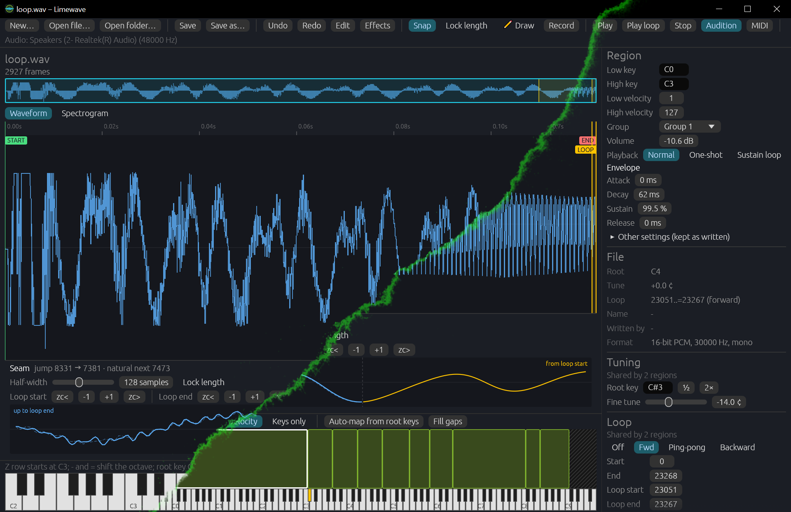

this is an early release, and made with the assistance of Claude. If you notice anything that needs fixing or features you want me to add, please raise an issue. Pull requests are also welcome.

Limewave is an open-source loop and one-shot WAV sample editor, written in Rust. Open a WAV file or a folder of them, set the loop points, root key and fine tune by hand, listen to the result while you edit, and save files that samplers read correctly. It runs on Windows, macOS and Linux.

What it does in version 0.7:

- Reads and writes PCM (8/16/24/32-bit) and 32/64-bit float WAV files, mono or stereo, at any sample rate.
- **New…** (toolbar): creates a blank, silent sample to draw on. Choose the length (in milliseconds or frames, up to 600 seconds), the sample rate, mono or stereo, the bit depth (16-bit, 24-bit or 32-bit float) and the root key, and whether to loop the whole file. **One cycle of** a note (such as A4) sets the length to one cycle of that note, the root key to the note and the loop to the whole file, and shows how many cents off the whole-frame cycle is. Creating a sample turns **Draw** on. The new file is called Untitled 1, 2 and so on, and counts as unsaved until you save it.
- **Record** (toolbar): records from an audio input into a new sample. The panel opens the system's default input device; choose another device, one input or a pair of inputs, and the bit depth to save at (16-bit, 24-bit or 32-bit float). The take is recorded at the device's own sample rate, with no resampling. A meter for each recorded channel shows the level from -60 to 0 dBFS, with a clip light that lights at -0.1 dBFS and goes out when you click it. Each take becomes a new file called Recording 1, 2 and so on, and the panel stays open for the next one. A take stops by itself at 10 minutes, or if audio is lost while the computer is busy; what was recorded is kept and the panel says why it stopped. If the device fails, what was recorded is kept, the panel shows the error and Record stays disabled until a device opens (choose it again to retry; the device is opened at its current sample rate and inputs). Closing the panel while recording asks whether to keep the take; closing the window keeps it as an unsaved file. The input device is open only while the panel is. There is no monitoring: listen through your audio interface. The button is disabled when no input device is found; it checks again when you point at it or come back to the window, so an interface switched on later is found without a restart.
- Reads the loop, root key and fine tune stored in the file's `smpl` chunk. Forward, ping-pong and backward loops are supported.
- Waveform view with zoom, scroll and an overview strip; draggable Start, Loop start, Loop end and End markers with optional zero-crossing snap. Drag a marker by its label as well as its line, or double-click the label to type an exact frame.
- **Waveform | Spectrogram** (switch above the main view): the spectrogram shows how the sound's frequencies change over time, in lime on a dark background, on a musical axis that runs from C1 up to half the sample rate (the highest frequency the file can hold), with a label at every C. Brightness is level in dB, down to a floor of -90 dB. It is computed in the background, and the waveform stays on screen until the picture is ready. Markers, selections, the play-from point, zoom and scroll work exactly as they do on the waveform. The overview and the seam view stay waveforms, and turning **Draw** on switches back to the waveform. Individual samples cannot be grabbed in the spectrogram when zoomed in, since that is a waveform edit. The choice is remembered between runs.
- A seam view that overlays the audio before the loop end on the audio after the loop start, so you can see a bad splice before you hear it, with nudge buttons and a "lock length" option.
- Loop crossfade (equal-power or linear), previewed live and rendered into the audio on save. Crossfade is switched off for backward loops.
- Selection and the **Edit** menu: drag on the waveform to select (Shift-click extends an existing selection, or makes one from the play-from point), then play the selection, set the loop to the selection, or set Start and End to the selection. **Crop to selection** removes the audio outside the selection right away (undoable); a loop crossing its edges is clipped to it. **Trim after loop end** and **Crop to loop** set the trims from the loop points, with an adjustable padding.
- The **Effects** menu: gain, normalize, fade in and out (linear, exponential or S-curve), invert polarity, remove DC offset, reverse, stereo to mono (keep the left or right channel, or mix them), swap left and right, mono to stereo, and auto-trim silence. Effects work on the selection, or on the whole file or Start to End when nothing is selected. Each is one undo step, and the effects run before the crossfade and the trim when you save.
- **Repair click** (in the **Effects** menu): select a click, pop or short dropout of up to 50 ms (at the file's current sample rate) and Limewave rebuilds the audio across it from the sound on either side, so the join is smooth. A mono file has one item; a stereo file has a submenu: **Both channels**, **Left only** or **Right only**, and the other channel is left untouched. It refuses, with a message, if the selection is longer than 50 ms or too close to the start or end of the file to have audio on both sides. The sample keeps its length, it is one undo step, and the repaired range is tinted as generated audio.
- **Change sample rate…** (in the **Effects** menu): convert the whole file to a new sample rate, keeping its pitch and length. The dialog shows the current rate, a digits-only **New rate** field (1,000 to 768,000 Hz), a **Common rates** dropdown, the length after the conversion, and, when going down, a warning that content above half the new rate will be removed (for example "Content above 11,025 Hz will be removed"). **Convert** renders in the background ("Converting…") with a band-limited resampler, and **Cancel** closes the dialog. It is one undo step. Start, End, the loop, the crossfade, cues, the selection and the play-from point all move with the audio; End and the loop end land on the matching last frame, and a loop squeezed under 2 frames is turned off. Undo brings the selection back. In an instrument it converts the selected region's sample, and every region that uses the sample follows.
- **Generate tail…** (in the **Effects** menu): cut the sample where the audio you want ends (the End marker) and Limewave replaces everything after it with a rendered tail, baked in on save. Two modes: **Decay** fades the sound out like a real ending (the decay time is fitted from the audio before the cut, or set by hand), and **Sustain** builds a steady body that loops seamlessly, followed by a release. Three methods: **Smooth** (spectral freeze, suggested for tonal sounds), **Harmonic** (partial resynthesis) and **Granular** (patches of the source stitched together, suggested for noisy sounds). A **Darken** control makes the highs fade faster, and the dialog suggests a mode and method from an analysis of the source. It previews the result before you apply it, with the audio from before the cut leading in, and **Play original** lets you compare with the untouched file.
- **Make loop from spectrum…** (in the **Effects** menu): make a seamless loop of 0.1 to 30 s from a range of the sample (the selection, or the whole file) by rebuilding it from its spectrum. **Steady** keeps the pitch and holds a constant level, **Ensemble** widens each harmonic by a Detune amount for a swirling, chorused sound, and **Plain** follows the average spectrum with no pitch. An entry transition glides from the original audio into the loop and an exit transition glides back out, so it sits inside a file. The loop is set as loop 0, forward, and needs no crossfade.
- Generated audio is tinted lime in the waveform, so you can see which audio is synthetic. A tail or a spectrum loop is one undo step. Rendering happens in the background, and the same settings always give the same audio (**New variation** in Ensemble and Plain gives a different one).
- Live audition through your sound card, from the computer keyboard, an on-screen keyboard or a MIDI keyboard. Loop edits are heard while notes are sounding.
- An ADSR envelope (attack, decay, sustain, release) for the audition notes. Stopping a note releases it instead of cutting it. **Release plays after loop end** (in the envelope section, off by default) makes a released looped note leave the loop and play on through the audio after the loop end, as a sampler with a sustain loop does; the envelope's release still applies, so a long release lets the whole tail be heard. The envelope and this setting are remembered between runs; they are not saved into WAV files.
- Playback cursors in the waveform, the overview and the seam view show where each sounding note is. A click on the waveform sets the point the **Play** button starts from.
- Right-click a key on the on-screen keyboard to set the root key. With a MIDI keyboard connected, "Set from MIDI" sets the root key from the next note you play.
- The window size and position are saved between runs by eframe's standard persistence, which also keeps egui's own layout memory, such as panel sizes. This has not yet been checked by hand.
- **SFZ instruments:** open an `.sfz` file, edit its regions and the samples they use, hear the whole instrument from the keyboard, build a new instrument from a folder of WAVs and save it with its samples. See [SFZ instruments](#sfz-instruments).
- Undo and redo for every edit.

*Screenshot coming soon.*

## Building and running

You need a recent stable Rust toolchain (https://rustup.rs).

```
cargo run --release -p limewave
```

To run the tests: `cargo test --workspace`.

On macOS, a bundled build must set `NSMicrophoneUsageDescription` to: Limewave records audio from your input device when you press Record.

To try the tail generator on a real sample from the command line, without the app, use the `tail_lab` bench. It cuts a file, renders a tail with each method you ask for, and writes the results (with the loop in the `smpl` chunk for sustain tails) into `target/tail-lab/<name>/` for listening:

```
cargo run --release -p limewave-core --example tail_lab -- <file.wav> --cut <seconds> --mode decay|sustain --method smooth|harmonic|granular|all [--body s] [--decay s] [--release s] [--darken 0..1] [--seed n] [--out dir]
```

It also prints the join, level and wave-shape measurements for each tail, and the render time.

On Linux, install the development packages for audio, MIDI and the window system first. On Debian and Ubuntu:

```
sudo apt-get install -y libasound2-dev libudev-dev libxkbcommon-dev
```

The application icon sources and PNGs live in `assets/icon`.

## SFZ instruments

An SFZ instrument is a plain-text file that spreads a set of WAV files across the keyboard, often in velocity layers. Limewave opens one, lets you fix what is wrong with it, plays it as a whole, and saves it with its samples.

**Opening.** Use **Open file…** and pick an `.sfz`, or click one in a folder's file list (instruments are listed at the top). Only one instrument is open at a time. While it is open, the file list is replaced by the region list and the keyboard strip by the key map. **Close instrument** (in the region list header) returns to what was open before.

**Region list** (left):

- One section per `<group>`, titled by its `group_label` or "Group 1", "Group 2" and so on. Each row shows the sample, root key, key range, a loop glyph, a dot if the region or its sample is unsaved, and "missing" if the sample file cannot be found. Click a row to select the region and open its sample in the editor.
- **Unassigned WAVs** lists WAV files in the instrument's sample folders that no region uses. **Add** adds a region for one.
- **Add group** adds an empty group. **Delete region** removes the selected region.

**Key map** (bottom) shows all 128 keys with a keyboard along its bottom edge.

- **Keys × velocity** draws a box per region over its key range and velocity range; **Keys only** draws one row per overlapping region. Keys that no region covers are hatched, and the boxes of the regions that are sounding light up.
- Click a box to select its region (click again to cycle through boxes that overlap). Drag a box's left or right edge to change its key range, and its top or bottom edge to change its velocity range. A drag is one undo step.
- Right-drag across the keyboard sets the selected region's key range to the keys you drag over.
- The **Velocity** control sets the velocity of notes played from the computer keyboard and the on-screen keys.
- **Auto-map from root keys** and **Fill gaps** both work on the selected region's group (every region when the instrument has no groups). Auto-map lays out the group's key ranges from the key each region sounds at (its root key, moved by any `transpose`), each range reaching halfway to its neighbours. Fill gaps extends the group's ranges to close the gaps between its regions without shrinking any. Both change key ranges only and are one undo step.

**Inspector.** A **Region** section above the usual ones edits the selected region:

- **Keys** (as note names) and **Velocity**; **Group**, which moves the region to the end of another group; **Volume** in dB.
- **Playback**: **Normal**, **One-shot** (plays the whole sample and ignores note-off) or **Sustain loop** (loops while the key is held, plays on past the loop end on release).
- **Envelope**: attack, decay, sustain and release for this region, saved as `ampeg_*`. A region with none uses the SFZ defaults. A region whose release is 0 gets a 5 ms release when Limewave plays it, so notes do not click off; this is for auditioning only and is not written to the file.
- **Other settings (kept as written)**: every other setting that applies to the region, read-only, with where it comes from. Those Limewave does not play are marked as not heard.

The **Tuning** and **Loop** sections edit the region's sample. Their values come from the instrument (`pitch_keycenter`, `tune`, `loop_*`), not from the WAV, because the instrument is what a sampler plays. **Fine tune is the opposite sign of `tune`**: Limewave's fine tune says how sharp the recording is, while `tune` says how much to raise it, so `tune=14` shows as a fine tune of -14 cents and is written back as `tune=14`. A `tune` beyond ±50 cents shows as the nearest root key plus the remaining cents, which is the same pitch: `pitch_keycenter=60 tune=80` shows as root key B3 with a fine tune of +20 cents. A loop with no `loop_type` in the instrument opens as forward, as a sampler plays it, whatever direction the WAV's own loop has.

**Shared samples.** Two regions can use the same WAV. The editor shows one waveform with one loop, labelled "Shared by N regions", and an edit changes every region that follows the sample. If a later region disagrees with the first about the root key, tuning or loop, it is marked as keeping its own tuning and loop: its values are read-only, are written back exactly as read, and are used when it plays. Fine tunes that differ only by rounding count as the same. A loop that is on for one and off for the other is a disagreement only when the region has loop points, its own or its group's; a region whose loop is switched on by its playback mode alone loops as the sample does, and one whose loop is off only because it plays **One-shot** or `no_loop` does not disagree. Which regions follow is decided against the sample as it was opened, and stays so until the instrument is saved or opened again (deleting the first region, for example, does not change it). While a region that keeps its own loop is selected, a note above the waveform reminds you that the loop markers still edit the shared sample.

**New instrument** (button at the top of a folder's file list) makes an unsaved instrument with one region per open WAV, each with the WAV's root key and fine tune (`pitch_keycenter` and `tune`), then runs Auto-map on it. The WAVs are not changed. WAVs whose names cannot be written as an SFZ value are left out (see Known limitations).

**Saving.** **Save** and **Save as…** open the save dialog with **SFZ instrument** chosen. For an instrument that has never been saved, a save-file picker asks for the name instead.

- **New folder** (the default) writes into `limewave` inside the instrument's folder. The samples go at the same relative paths, so the folder is complete on its own. Samples outside the instrument's folder (a `..` or absolute path) are gathered into `samples/` and the instrument's paths are changed to match.
- **Overwrite originals** replaces the `.sfz` and each changed WAV, first copying each to a numbered `.bak`.
- **Also write loop and root key into each WAV (smpl)** is off by default. Off, each WAV keeps the loop and root key it had, and the instrument carries your edits. On, the edited values are written into the WAV as well. Either way, a crossfade, trims and effects are written into the WAV's audio; the crossfade is made at the loop as you edited it.
- An untitled instrument saved through the save-file picker into the folder its WAVs are in uses those WAVs where they are: a changed WAV is replaced there, first copied to a numbered `.bak`, and unchanged ones are left alone.
- **Individual WAV files** saves the samples only, without changing the instrument, which stays unsaved.
- After saving, the saved instrument is reopened from disk with the same region selected, and undo history starts fresh.

## Keyboard shortcuts

Notes play when the **Audition** toggle is on and no text field has focus.

| Keys                                                                    | Action                                                                                                                                                 |
| ----------------------------------------------------------------------- | ------------------------------------------------------------------------------------------------------------------------------------------------------ |
| Z S X D C V G B H N J M ,                                               | Lower row of notes (white keys on the bottom row, black keys on the row above). Starts at C3 by default.                                               |
| Q 2 W 3 E R 5 T 6 Y 7 U I                                               | Upper row of notes, one octave higher than the lower row.                                                                                              |
| - and =                                                                 | Move both rows down or up one octave.                                                                                                                  |
| Ctrl/Cmd+Z                                                              | Undo. With an instrument open, this undoes the most recent edit, whether it was to the instrument (a key range, a region) or to the selected sample.   |
| Ctrl/Cmd+Shift+Z or Ctrl/Cmd+Y                                          | Redo, in the same order                                                                                                                                |
| Ctrl/Cmd+A                                                              | Select Start…End                                                                                                                                       |
| Escape                                                                  | Cancel "Set from MIDI"; otherwise turn Draw off; otherwise clear the selection and the play-from point. With a menu open, Escape only closes the menu. |
| Ctrl/Cmd+S                                                              | Save                                                                                                                                                   |
| Ctrl/Cmd+Shift+S                                                        | Save as…                                                                                                                                               |
| Hold Shift while dragging a marker                                      | Turn zero-crossing snap off for that drag                                                                                                              |
| Shift-click on the waveform                                             | Extend an existing selection, or make one from the play-from point                                                                                     |
| Mouse wheel over the waveform                                           | Zoom around the cursor                                                                                                                                 |
| Drag the overview box                                                   | Scroll                                                                                                                                                 |
| Drag either edge of the overview box                                    | Zoom, keeping the other edge in place                                                                                                                  |
| Drag a sample dot (zoomed in until samples show as dots, with Draw off) | Move that sample up or down; drag sideways to draw over the samples you pass, like a pencil. Each stroke is one undo step.                             |
| Draw (toolbar)                                                          | Drag on a channel to draw its waveform at any zoom; each stroke is one undo step. Escape turns it off.                                                 |
| Hold Shift while drawing samples (with Draw off)                        | Fine control: the sample moves a tenth as far as the pointer                                                                                           |
| Right-drag across the key map's keyboard (instrument open)              | Set the selected region's key range to the keys you drag over. Right-click without dragging still sets the root key.                                   |

Note names follow the convention that MIDI note 60 is C4.

With an instrument open, notes from the computer keyboard and the on-screen keys use the **Velocity** control in the key map (1 to 127, default 100). Notes from a MIDI keyboard use their own velocity.

## What gets written when you save

- The audio is saved in the file's original format (same bit depth). The sample rate is the original's unless you converted it with **Change sample rate…**. Only the frames between the Start and End markers are kept.
- A converted file is written with its new rate in the `fmt ` chunk (with the byte rate) and as the sample period in `smpl`.
- A `smpl` chunk holds the root key, fine tune and loop. The loop end is stored inclusive, and the fine tune is stored the way the RIFF definition describes it (a pitch fraction upward from the unity note). With the loop off, the chunk is written with zero loops so the root key and tune still travel with the file. If a file had no `smpl` chunk and you changed nothing about tuning or looping, none is added.
- A `LIST/INFO` chunk with `ISFT` set to `Limewave <version>`. Other INFO fields (such as the name) are kept.
- Every chunk Limewave does not edit is kept, including cue markers and their labels (`cue ` and `LIST/adtl`). Cue positions follow trims and reverses, and cues that fall outside the saved range are dropped with their labels. The `fact` chunk follows the saved frame count.
- Effects, a generated tail or spectrum loop, a crossfade and trims are baked into the saved audio. A tail replaces everything after the End marker, and a spectrum loop replaces the range it was made from, so the saved file can be longer or shorter than the original; the `fact` chunk, cue positions and later loops follow. The save dialog lists any extra `smpl` loops that a tail or spectrum loop replaced, since those cannot be kept. A WAV file does not record that they were applied, so a saved file reopens with a crossfade of 0 and no effects to undo.
- Other chunks are copied through unchanged, in their original order. When you change the root key or fine tune, existing `inst` and `acid` chunks have their root note (and, for `inst`, fine tune) updated to agree with the `smpl` chunk; otherwise they are left as they are. A file without a `smpl` chunk opens with the root key and fine tune of its `inst` chunk, or else the root key of its `acid` chunk when that chunk marks it as set.
- A file you open and save with no edits comes back byte for byte, apart from the `ISFT` tag.

When you save an SFZ instrument:

- Only the settings you edited are changed in the `.sfz`, and always in the region itself: a value a region inherits from its group is written as a setting of its own, and the group is not touched.
- Comments, `#define` lines, headers Limewave does not use and settings it does not understand are kept, in their original order and with their original text. Values that used a `$NAME` are written back with the `$NAME`.
- The layout is normalised: each header starts a line, settings follow one per line, and a blank line separates regions. Line endings follow the original file.
- Key range and root key edits keep the spelling of the value they change: a number stays a number and a note name stays a note name. A new key range is written as note names, a new root key as a number.
- When a sample's root key or fine tune changes, every region that follows it gets explicit `pitch_keycenter` and `tune`; when its loop changes, they get explicit `loop_start` and `loop_end`, `loop_mode=loop_continuous` where it is unset, or `no_loop` when the loop was turned on, `loop_mode=no_loop` where the loop was turned off on a region that looped (and a `loop_start` or `loop_end` that was the sample's loop is removed from them), and `loop_type` whenever the loop direction changed from what was read on opening (forward included). A **One-shot** region stays one-shot. When a sample's Start marker moves, `offset`, `end` and the loop settings of the regions that use it shift with it. When a sample is cropped, given a tail or spectrum loop, or converted to a new rate, `offset`, `end`, `loop_start` and `loop_end` on every region that uses it move with the audio to its new frames (also for regions that keep their own tuning and loop), written at region level and kept inside the audio that remains; a value inside audio a crop removed lands at the cut. A loop that this cuts away turns off on the regions that followed it. Tuning is unchanged. The WAV's own loop moves with the audio too.
- The WAVs follow the rules above. A WAV whose content would come out the same is copied byte for byte (new folder) or left alone (overwrite). With the `smpl` checkbox off, a sample whose only change is its loop or tuning comes out the same, since the instrument carries that change.

Where files go:

- By default a save writes into a new `limewave` folder next to the source file, keeping the file name. Your originals are not touched.
- Originals are modified only if you choose **Overwrite originals**, or save an untitled instrument into the folder its WAVs are in (see [SFZ instruments](#sfz-instruments)). Each file is first copied to `<name>.wav.bak` (or `.1.bak`, `.2.bak` and so on if that exists); if the backup fails, that file is not saved.
- A file that Limewave itself wrote into its output folder, and then reopened, is replaced in place when you save it again.
- Limewave asks before replacing any other existing file.
- Files are written to a temporary file and renamed into place, so a failed save never leaves a half-written file.
- After a save, the open document continues from the saved audio and the undo history starts fresh.

## Checking tuning in your sampler

A small pack of test files lets you confirm that tuning and looping come out right in the sampler of your choice:

```
cargo run -p limewave-core --example check_pack --features testwav -- <out dir>
```

This writes three 48 kHz, 16-bit mono files, each with root note 69 (A4): `sine_A4_plus25c.wav` and `sine_A4_minus25c.wav` (sines 25 cents above and below 440 Hz, tuned by +25 and -25 cents) and `sine_A4_loop.wav` (a 440 Hz sine with an exact-period loop). Each should play in tune at A4, and the last should loop without a click.

## Known limitations

- Cue markers are kept in the file but Limewave does not show or edit them.
- The envelope is for audition only. It is not saved into WAV files.
- A backward loop has no crossfade.
- Many samplers ignore backward loops, so check one in yours before relying on it.
- When you switch files quickly, only the most recent release tail keeps sounding.
- Tails are rebuilt from the audio before the cut, so a sound whose ending differs from its body cannot be predicted. The known weak case is a low drum whose pitch falls: it is not detected as tonal, and its tail fades more slowly than the real ending would. Set the decay time by ear.
- The Harmonic method's sustain body drifts in level more than the other two (about 3.6 dB on one real tonal sample, against about 1 dB for Granular and 0.6 dB for Smooth). Listen before relying on it for a sustained loop.
- Spectrum loops at very low pitches and high sample rates take a few seconds to render. They render in the background, so the window stays usable.
- A tail or spectrum loop is stored as the audio it rendered. To change its settings, undo it and apply it again.
- Repair click rebuilds the gap from the sound around it, so the longer end of its 50 ms range works best on steady sounds such as sustained notes. On a sound that changes quickly across the gap, keep the selection as short as the damage allows.
- Rate conversion rounds loop points to the nearest frame, so a seamless loop may need a nudge in the seam view afterwards.
- Converting a file twice resamples it twice, which loses a little more of the top of the spectrum each time. Convert once, straight to the rate you want.
- After a conversion, cue ranges and any `smpl` loops beyond the first can be a frame off.
- Converting a long file to a very high rate takes a while. It runs in the background, so the window stays usable.
- SFZ: `#include` is not supported. An instrument that uses it is refused with a message, and nothing is opened.
- SFZ: these are kept when you save but are not heard in Limewave: filters, pitch and filter envelopes, LFOs, pan and width, round robins, crossfaded layers, release triggers, keyswitches, controller (CC) modulation and effects.
- SFZ: only one instrument can be open at a time.
- SFZ: WAV names that cannot be written as an SFZ value (for example a space followed by `name=`, or a name containing `<`, `//` or `$`) are left out of new instruments.

## Roadmap

1. **Pitch detection:** detect the root key and fine tune, with octave fixes and root keys read from file names.
2. **Classifier:** tell one-shots, truncated samples, sustained sounds and rhythmic material apart, and suggest sensible editor defaults.
3. **Auto loop finder:** ranked loop candidates found from self-similarity and refined at sample level, shown beside the seam view.
4. **Beat slicing:** cut rhythmic loops into hits at detected onsets, with a rendered tail for each slice.

Possible later: batch processing over a folder, a command-line tool, a CLAP plugin.

## Licence

Licensed under either of

- Apache License, Version 2.0 ([LICENSE-APACHE](LICENSE-APACHE))
- MIT licence ([LICENSE-MIT](LICENSE-MIT))

at your option.
